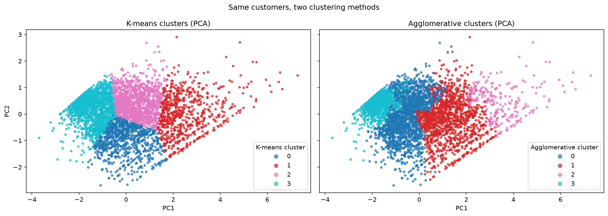

# Customer Segmentation of an Online Retailer with RFM and Clustering

**CSC 3730: Machine Learning and Data Analytics, Fall 2026 (LSU), Group 6**

Hammaad Alam, Nick Jaramillo, Fahd Khattak, Damien Nguyen, Madison Nguyen, Taylor Wall, Demetri Williams

## Overview

An online retailer has a year of transactions but no labels saying which customers are valuable, at risk, or new. We build Recency, Frequency, and Monetary (RFM) features for each customer, group customers with K-means, check the result against agglomerative (hierarchical) clustering, and turn the segments into marketing recommendations.

Everything is in one notebook: [`customer_segmentation.ipynb`](customer_segmentation.ipynb).

## Dataset

[Online Retail](https://archive.ics.uci.edu/dataset/352/online+retail) from the UCI Machine Learning Repository: 541,909 invoice line items from a UK-based online gift retailer, 1 December 2010 to 9 December 2011. The workbook is included in this repository as `Online Retail.xlsx`.

> Chen, D. (2015). *Online Retail* [Dataset]. UCI Machine Learning Repository. https://doi.org/10.24432/C5BW33

## Method

| Step | What we do |
|---|---|
| Preprocessing | Drop rows with no `CustomerID`, cancellation rows, and rows with a zero or negative quantity or price: 541,909 rows become 397,884 purchases by 4,338 customers |
| Features | Recency (days since last purchase), Frequency (distinct invoices), Monetary (total spending), then `log1p` and standardization |
| Choosing K | K-means for K = 2 to 10, compared with the elbow method and silhouette scores; K = 4 selected |
| Final model | K-means with K = 4, with a random-seed stability check and a 2D PCA plot |
| Second method | Agglomerative clustering (Ward linkage) on the same features and same K, with a dendrogram |
| Comparison | Silhouette scores, Adjusted Rand Index (ARI), cluster sizes, median RFM profiles, and a crosstab |
| Interpretation | Named segments, segment behaviour, and marketing recommendations with KPIs |

## Results

**Segments from the final K-means model (K = 4)**

| Segment | Customers | Share of customers | Share of revenue | Median recency (days) | Median orders | Median spending (GBP) |
|---|---|---|---|---|---|---|
| Loyal high-value | 716 | 16.5% | 64.9% | 8 | 10 | 3,734 |
| Mid-value at risk | 1,173 | 27.0% | 23.7% | 56 | 4 | 1,346 |
| Recent low spenders | 837 | 19.3% | 5.2% | 17 | 2 | 472 |
| Inactive one-time | 1,612 | 37.2% | 6.2% | 177 | 1 | 298 |

**K-means compared with agglomerative clustering**

| | K-means | Agglomerative (Ward) |
|---|---|---|
| Silhouette score | 0.337 | 0.242 |
| Cluster sizes | 716 to 1,612 | 242 to 1,820 |

- The two methods agree with an **ARI of 0.25**: they find the same small high-value group and the same long-inactive group, but draw the boundaries between the middle segments differently.
- K-means is stable across random seeds (ARI 0.94 to 0.99 against the final model), so the difference comes from the method and not from randomness.
- We use K-means for the final segments because its clusters are better separated and more balanced, and new customers can be assigned to a segment from the centroids.



The notebook ends with the limitations of the analysis, a conclusion, and the full reference list.

## How to run

```bash
git clone https://github.com/HammaadAlam/3730-Customer-Segmentation.git
cd 3730-Customer-Segmentation
pip install -r requirements.txt
jupyter notebook customer_segmentation.ipynb
```

Then choose **Kernel > Restart & Run All**. The notebook takes under a minute and writes every figure to `figures/`. Random seeds are fixed, so the results above are reproduced exactly.

Last verified with Python 3.12, numpy 2.5, pandas 3.1, scikit-learn 1.9, scipy 1.18, and matplotlib 3.11.

## Repository structure

```
customer_segmentation.ipynb   Full analysis with outputs
Online Retail.xlsx            UCI Online Retail dataset
figures/                      Figures saved by the notebook (for the report and slides)
requirements.txt              Python dependencies
README.md
```

## References

1. Chen, D. (2015). *Online Retail* [Dataset]. UCI Machine Learning Repository. https://doi.org/10.24432/C5BW33
2. Chen, D., Sain, S. L., & Guo, K. (2012). Data mining for the online retail industry: A case study of RFM model-based customer segmentation using data mining. *Journal of Database Marketing & Customer Strategy Management, 19*(3), 197-208.
3. Aljabea, I. (2026). *Module 10: Unsupervised Learning* (lecture slides and code). CSC 3730, Louisiana State University.
4. Pedregosa, F., et al. (2011). Scikit-learn: Machine learning in Python. *Journal of Machine Learning Research, 12*, 2825-2830.

The complete list is at the end of the notebook.
